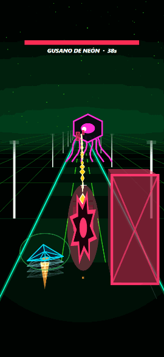
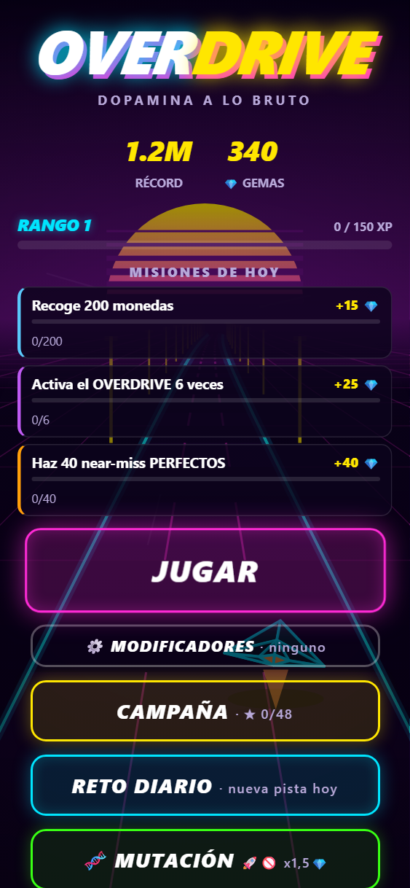
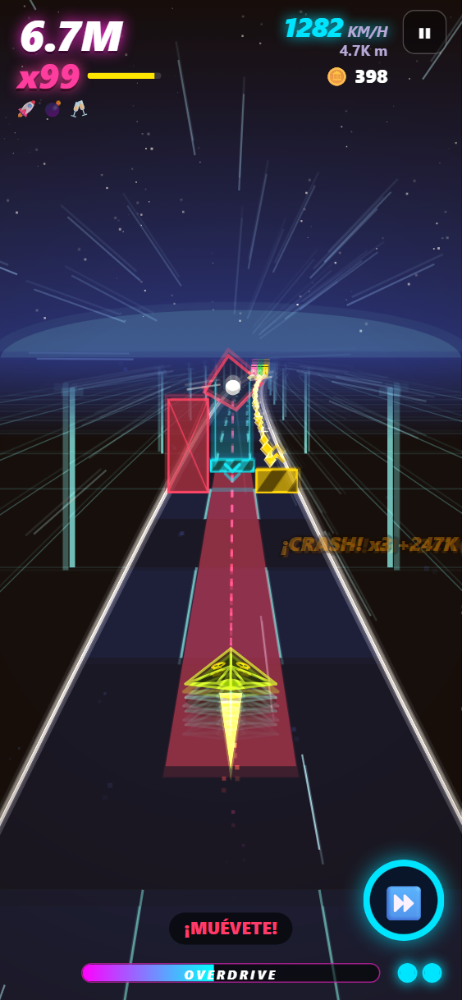
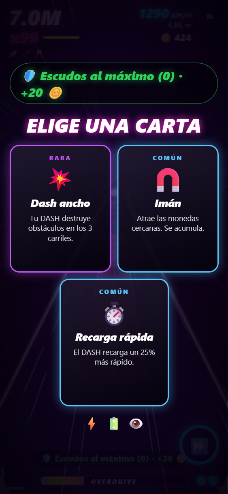
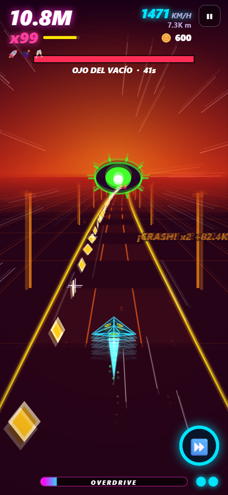
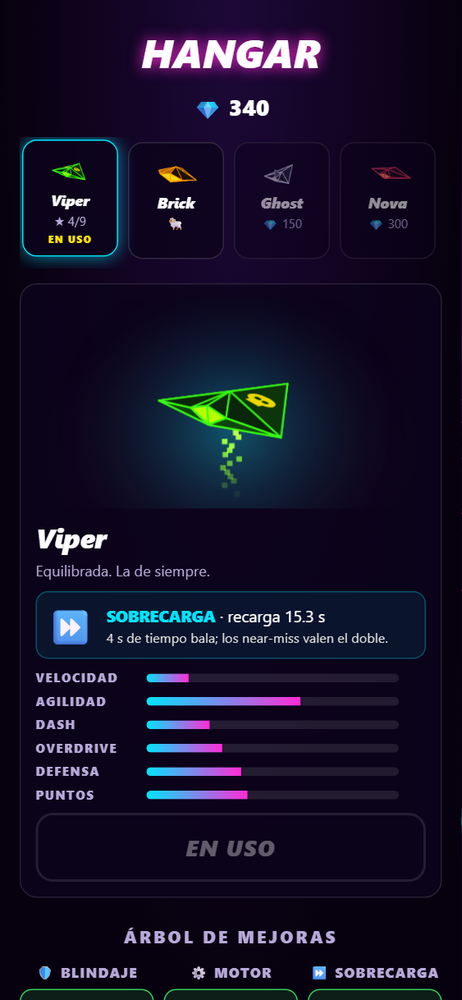
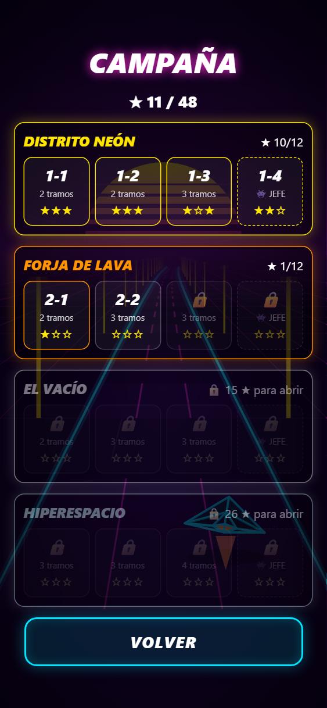
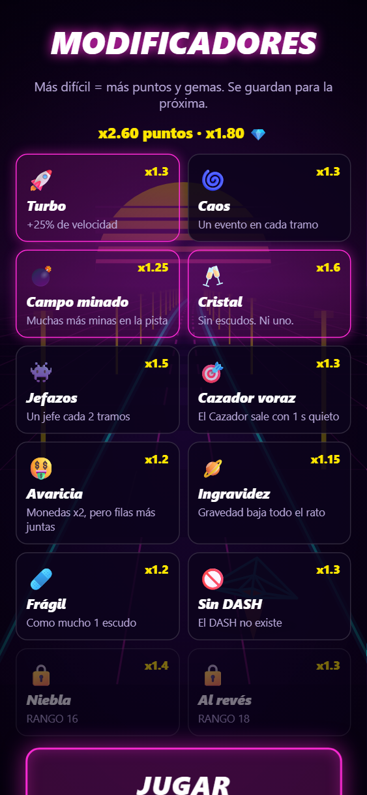

<div align="center">

# ⚡ OVERDRIVE

**Runner de velocidad neón para el móvil. Dopamina a lo bruto.**

### [▶ JUGAR AHORA](https://ahiram1701.github.io/overdrive/)

[](https://github.com/ahiram1701/overdrive/actions/workflows/ci.yml)
[](https://github.com/ahiram1701/overdrive/actions/workflows/deploy.yml)




      

</div>

## 📲 Instalar en el móvil
1. Abre **https://ahiram1701.github.io/overdrive/** en Chrome (Android) o Safari (iOS).
2. Elige **Añadir a pantalla de inicio** o **Instalar app**.
3. Se abre a pantalla completa y funciona **sin conexión**.

La vibración solo funciona en Android; iOS no soporta `navigator.vibrate`.

## 🎮 Controles

| Acción | Móvil | Teclado |
|---|---|---|
| Cambiar de carril | deslizar ← → | ← → / A D |
| Saltar | deslizar ↑ | ↑ / W |
| Deslizarse (en el aire: caída rápida) | deslizar ↓ | ↓ / S |
| **DASH**: rompe lo que tengas delante | doble toque | Espacio |
| Pausa | botón ❚❚ | P / Esc |

Puedes encadenar swipes sin levantar el dedo.

## 🚦 Leer los obstáculos
El **cuerpo** te dice qué es y el **chevrón** (▲ ▼) qué hacer, igual en todos los biomas:

| Aspecto | Qué hacer | Qué es |
|---|---|---|
| 🟥 **Magenta** con X | Cambia de carril o haz DASH (no se puede saltar) | muros, muros móviles (▶ indica hacia dónde van), puertas |
| 🟨 **Amarillo ▲** | Salta | barreras, láser bajo |
| 🟦 **Cian ▼** | Deslízate por debajo (tampoco se salta) | barra colgante, láser alto |
| 🔴 **Rojo con picos** | Esquiva; si lleva ▲, también se puede saltar | disparos del jefe y del Cazador, minas |
| 🟢 **Verde** | ¡Ve a por él con DASH! | núcleo del jefe |
| 🟡 **Rombo dorado** con destello | Cógelo | monedas (lo único dorado de la pista) |

**Elementos especiales:**
- **Pinzas** (magenta ▶◀): dos mandíbulas cierran un carril justo antes de llegar.
- **Rodillos** (amarillo ▲): ruedan hacia ti más rápido que la pista.
- **Plataformas que caen** (cian ▼): bajan del techo en el último momento.
- 🌀 **Portales**: te cambian de carril; la flecha indica a cuál.
- 🟢 **Rampas**: te lanzan por los aires con un arco de monedas.
- **Rieles**: súbete saltando su punta y haz *grind*, que suma puntos, combo y overdrive mientras lo recorres.
- 🎯 **Dianas**: rómpelas con DASH, láser u overdrive para un bonus.

## 🔥 Cómo sacar puntos
- **Near-miss:** pasa rozando un obstáculo justo después de moverte. Si lo haces en el último instante es un **¡PERFECTO!**, con cámara lenta incluida.
- **Combo (x1 → x99):** sube con near-miss, roturas y monedas. Si pasan 3 s sin hacer nada empieza a bajar, y un golpe lo reinicia.
- **OVERDRIVE:** se carga con near-miss y roturas. Durante unos segundos eres invencible, todo lo que tocas explota, vas un 50% más rápido y puntúas el doble.
- **Escudos (máx. 3):** cada uno aguanta un golpe, pero un golpe nunca da nada: pierdes el escudo, el combo y medio overdrive. Solo se consiguen en bifurcaciones, cofres, cartas o con **Vampiro**, que da uno cada 12 near-miss.
- **El Cazador:** si pasas 3 s sin tocar nada aparece un dron que marca tu carril en rojo y dispara. Sus disparos atraviesan la invulnerabilidad. Esquiva 2 seguidos y se retira con un **¡ESCAPASTE!** y bonus. Cada vez que vuelve, tarda menos en aparecer.
- **Velocidad:** no para de subir. Hay avisos a los 500 km/h, en MACH 1, en MACH 2…

## 🌍 Biomas, set pieces y eventos
- **Cada bioma tiene su mecánica:**
  - **Túnel de lava:** ríos de lava que recorren un carril.
  - **Vacío glitch:** muros que saltan de carril; un fantasma verde marca el destino antes.
  - **Hiperespacio:** gravedad baja, con saltos más largos y flotantes.
  - **Neón urbano:** cortinas de láser bajo y alto seguidas.
- **Set pieces:** desde el tramo 3, a veces aparece una secuencia guionizada con aviso: **TÚNEL** (rieles y portales), **ESTAMPIDA** (oleada de rodillos), **LLUVIA DE MINAS** o **AGUJERO DE GUSANO** (el mundo gira).
- **Eventos:** controles invertidos, mundo al revés, lluvia de monedas, solo near-miss, **apagón** (solo ves lo cercano), **tormenta magnética** (todas las monedas vienen a ti) y **combo doble**.

## 👾 Jefes
Cada 3 tramos aparece un jefe. Hay 5, cada uno con su forma, sus ataques y una **segunda fase** al llegar al 50% de vida:

| Jefe | Fase 1 | Fase 2 |
|---|---|---|
| **Gusano de neón** | disparos | + lluvia de muros |
| **Ojo del vacío** | rayo (marca los carriles en rojo antes de disparar) | + disparos |
| **Devorador** | minas + succión hacia su carril | + disparos |
| **El Censor** | ráfaga en todos los carriles menos uno; núcleo **blindado** (el láser rebota: solo DASH) | + rayo |
| **Mamá Ovni** | disparos + dianas | ráfaga + dianas + minas |

## 🧪 Modificadores y mutación del día
- **12 modificadores** que cambian las reglas a cambio de **más puntos y gemas**:
  - Turbo, Caos, Campo minado, Cristal, Jefazos, Cazador voraz;
  - Avaricia, Ingravidez, Frágil, Sin DASH, Niebla y Al revés.
- Se activan en **⚙️ MODIFICADORES**, bajo JUGAR, y se recuerdan para la próxima partida.
- El bonus se multiplica: Turbo + Cristal = x2,08 puntos. Las gemas suben la mitad, con tope x3.
- Se **desbloquean con el rango**, uno cada pocos rangos: siempre hay uno nuevo a la vista.
- **🧬 Mutación del día:** cada día, 2 modificadores y la misma pista para todos. El primer intento paga **x1,5 gemas**.
- Los tests comprueban que el bot sobrevive sin golpes con cada modificador que cambia la pista.

## 🗺️ Campaña
Además del modo infinito hay una **campaña de 16 niveles** en 4 sectores (Distrito neón, Forja de lava, El vacío e Hiperespacio):
- Cada nivel tiene **pista fija** (siempre la misma, para aprendértela), un número de tramos y una **línea de META**. El 4.º nivel de cada sector es un **jefe**.
- **3 estrellas por nivel:** llegar a la meta (o derrotar al jefe) y dos objetivos más, como "sin perder escudos", "25 near-miss", "combo x35" o "120 monedas". Las estrellas se guardan: nunca se pierden.
- Superar un nivel abre el siguiente; los **sectores se abren con estrellas** (6, 15 y 26).
- La primera vez que superas un nivel ganas sus gemas, y cada estrella nueva da +5 💎.
- Los tests comprueban que el bot llega a la meta de **todos** los niveles sin un solo golpe: ninguna pista fija es injusta.

## 🛣️ Estructura de una partida
1. **Tramos** con biomas que rotan: Neón urbano, Túnel de lava, Vacío glitch e Hiperespacio. En mitad de un tramo puede saltar un **evento**: controles invertidos, mundo al revés, lluvia de monedas o "solo near-miss".
2. Al final de cada tramo, una **bifurcación**: elige carril según la recompensa (☠️ Riesgo x2, 🛒 Tienda, 🎁 Cofre, 🛡️ Escudo, 🪙 Monedas, 🃏 Cartas raras).
3. Después **eliges 1 de 3 cartas**. Las cartas cambian las reglas y se combinan en sinergias.
4. **Cada 3 tramos, un jefe.** Esquiva sus disparos y haz **DASH contra sus núcleos verdes** antes de que escape.
5. Al morir ganas **gemas 💎** para el hangar: naves nuevas y mejoras permanentes.
6. **Reto diario:** la misma pista para todo el mundo durante el día, elijas lo que elijas.

## ⚡ Habilidades y hangar
- **Cada nave tiene una habilidad activa propia.** Se lanza con el botón ⚡ (abajo a la derecha) o con **E**/**Q** en el teclado. Tiene un tiempo de recarga, que se ve en el anillo del botón, y **cada near-miss lo recorta 0,3 s**.
- **Árbol de mejoras por nave** en el hangar: 3 ramas de 3 niveles que se compran con gemas.
  - 🛡️ **BLINDAJE:** escudo inicial, más invulnerabilidad y ÚLTIMO ALIENTO.
  - ⚙️ **MOTOR:** agilidad, una carga extra de DASH y más OVERDRIVE.
  - **La rama de la habilidad:** recarga, potencia y, en el nivel 3, una **mutación** que cambia cómo funciona.
- **Ficha de cada nave:** 6 barras (velocidad, agilidad, DASH, overdrive, defensa y puntos), calculadas con las reglas reales del juego y comparadas con tu nave equipada (▲ mejor, ▼ peor).
- **Vista 3D:** la nave gira en el hangar (arrástrala para girarla) con su pintura, su emblema y su estela.
- **Personalización por nave:** cada nave lleva su propia **pintura, estela, explosión y emblema**.
  - Lo que compras con gemas vale **solo para esa nave**. Lo que da el rango o un logro vale para todas.
  - **Exclusivos** que se ganan usando la nave: 2 pinturas (30 tramos y 5 jefes con ella) y su **insignia**, la silueta de la propia nave (20 partidas).
  - **Pruébalo antes de comprar:** tocar cualquier objeto lo pone en la vista 3D. La explosión estalla y la nave se vuelve a montar.
  - **Emblema a tu gusto:** en las dos alas, en una sola o en la cola, y en el color que quieras (gratis). Siempre cabe dentro de su cara: se centra en el incentro del triángulo y se recorta a su contorno.
  - **Pinturas con patrón** (Tigre a franjas, Dúo partida, Aurora en degradado), estelas de **Humo** y **Relámpago**, y explosiones **Agujero negro** y **Fuegos artificiales**.

## 🏆 Rango, logros y colección
- **Rango de piloto (1-30):** cada partida da XP según distancia, near-miss, tramos, jefes y misiones. Cada rango nuevo da gemas.
- **34 logros** de bronce, plata y oro (20/40/80 💎): de "100 near-miss" a "100 millones de puntos en una partida". Al desbloquear uno en plena partida se celebra en el momento.
- **Colección:** las cartas, sinergias y jefes que has visto. Lo que te falta aparece en silueta.

## 🎯 Misiones diarias
Cada día hay **3 misiones**, una fácil (+15 💎), una media (+25 💎) y una difícil (+40 💎). Son las mismas para todos y cambian a medianoche. Algunas se acumulan durante el día ("haz 60 near-miss") y otras hay que lograrlas en una sola partida ("llega a x50 de combo"). Al completar una en plena partida se celebra en el momento y las gemas se suman al instante. El progreso se ve en el menú y en la pantalla final.

<!-- CARDS:START -->
### Cartas
| | Carta | Rareza | Efecto | Máx. |
|---|---|---|---|---|
| 🧲 | **Imán** | común | Atrae las monedas cercanas. Se acumula. | 3 |
| ⚡ | **Doble carga** | rara | +1 carga de DASH. | 2 |
| 🛡️ | **Escudo** | rara | Aguanta 1 golpe (máximo 3 escudos). | 2 |
| 👁️ | **Reflejos** | común | Ventana de near-miss más grande y cámara lenta más larga. | 3 |
| 💉 | **Adrenalina** | rara | Cada near-miss recarga media carga de DASH. | 1 |
| 🌋 | **Terremoto** | rara | Al aterrizar de un salto destruyes lo que tengas delante en tu carril. | 1 |
| 🦘 | **Salto doble** | rara | Puedes saltar otra vez en el aire. | 1 |
| 💥 | **Dash ancho** | rara | Tu DASH destruye obstáculos en los 3 carriles. | 1 |
| 🧨 | **Explosivo** | épica | Lo que rompes explota y arrasa todo lo cercano en cadena. | 1 |
| 🔥 | **Overdrive+** | común | El OVERDRIVE dura +2 s. | 3 |
| 🔋 | **Cargador** | común | El OVERDRIVE se llena un 35% más rápido. | 3 |
| 🪙 | **Monedas de oro** | común | Cada moneda vale +1. | 3 |
| 💎 | **Pacto de cristal** | épica | x3 PUNTOS… pero pierdes un carril para siempre. | 1 |
| 🚀 | **Nitro loco** | épica | +50% de velocidad y x2 PUNTOS. | 1 |
| 🧛 | **Vampiro** | rara | Cada 12 near-miss ganas un escudo. | 1 |
| 🧷 | **Seguro de combo** | común | Perder un escudo no reinicia tu combo. | 1 |
| ⏱️ | **Recarga rápida** | común | El DASH recarga un 25% más rápido. | 3 |
| 🪶 | **Ágil** | común | Cambias de carril y saltas más rápido. | 2 |

### Sinergias
Si tienes las dos cartas de una sinergia, se activa un efecto extra.

| Sinergia | Combina | Efecto |
|---|---|---|
| **SUPERNOVA** | 🧲 Imán + 🔥 Overdrive+ | En OVERDRIVE las monedas valen x3 y el imán es gigante. |
| **BULLDOZER** | 🧨 Explosivo + 💥 Dash ancho | DASH +50% de duración y recarga un 30% más rápido. |
| **ZEN** | 👁️ Reflejos + 💉 Adrenalina | Los near-miss PERFECTOS cargan un 15% extra de OVERDRIVE. |
| **METEORO** | 🦘 Salto doble + 🌋 Terremoto | Terremoto con doble alcance y +500 puntos por golpe. |
| **KAMIKAZE** | 💎 Pacto de cristal + 🚀 Nitro loco | x2 PUNTOS extra. Sí, otra vez. |
| **SANGRE DORADA** | 🧛 Vampiro + 🪙 Monedas de oro | Cada moneda suma combo extra. |

### Naves (hangar)
| Nave | Coste | Pasiva | Habilidad activa ⚡ | ★ Mutación (árbol, nivel 3) |
|---|---|---|---|---|
| **Viper** | gratis | Equilibrada. La de siempre. | ⏩ **SOBRECARGA** (18 s): 4 s de tiempo bala; los near-miss valen el doble. | Cada near-miss alarga la SOBRECARGA 0,3 s |
| **Brick** | 💎 60 | Empieza con 2 escudos, pero cambia de carril más lento. | 🐏 **ARIETE** (20 s): 2,5 s rompiendo todo lo que tocas (sin poder saltar). | Cada rotura con el ARIETE recarga 1 s |
| **Ghost** | 💎 150 | Ventana de near-miss enorme y DASH que recarga rápido. | 👻 **FASE** (16 s): 1,2 s intangible: lo que atraviesas cuenta como PERFECTO. | Al salir de FASE, una onda rompe lo cercano |
| **Nova** | 💎 300 | OVERDRIVE se llena un 60% más rápido y dura +2 s. | 💥 **ESTALLIDO** (25 s): +50% de overdrive y arrasa todo lo que tienes delante. | ESTALLIDO llena el OVERDRIVE entero |
| **Kaiju** | 💎 500 | Empieza con Dash ancho y Explosivo (¡BULLDOZER!), pero x0.7 puntos. | 🦖 **RUGIDO** (30 s): Limpia los 3 carriles por delante y atrae todas las monedas. | RUGIDO te da 1 escudo |
| **Raptor** | 💎 400 | Nerviosa: cambia de carril un 20% más rápido y su DASH recarga antes. | 🔫 **LÁSER** (6 s): Dispara por tu carril y rompe el primer obstáculo (o daña al jefe). | Dispara en los 3 carriles |
| **Comet** | 💎 650 | Cazatesoros: cada moneda vale +1 y el imán viene de serie, pero el OVERDRIVE carga un 20% más lento. | 🪝 **GANCHO** (10 s): Te lanza al carril del extremo opuesto al instante. | El GANCHO arrasa lo que tienes delante |
<!-- CARDS:END -->

### Ajustes del menú
🔊 sonido · 📳 vibración · ✨ efectos intensos (shake, flashes) · **Aa** textos en pantalla: normal o mínimo.

## 🛠️ Desarrollo
El juego no necesita build (HTML, CSS y JS nativos); Node solo hace falta para las herramientas.

```bash
npm ci
npx playwright install chromium
npm run serve
```

Con `npm run serve` el juego queda en http://localhost:8080.

| Comando | Qué hace |
|---|---|
| `npm test` | Lint + tests unitarios + E2E (un bot juega con semillas fijas y falla si la pista se vuelve imposible) |
| `npm run screenshots` | Regenera las capturas y el GIF de `docs/` |
| `npm run docs:cards` | Regenera las tablas de cartas, sinergias y naves de este README |

URL de desarrollo: `?nosw` desactiva la caché offline; `?debug` muestra los FPS y expone `G` y `D` en la consola; `?debug&seed=N` fija la pista.

**Flujo:** rama → PR (la CI tiene que pasar) → merge a `main` → despliegue automático en GitHub Pages, con la caché del service worker versionada por commit.
